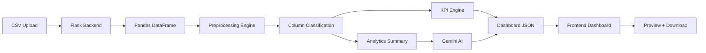
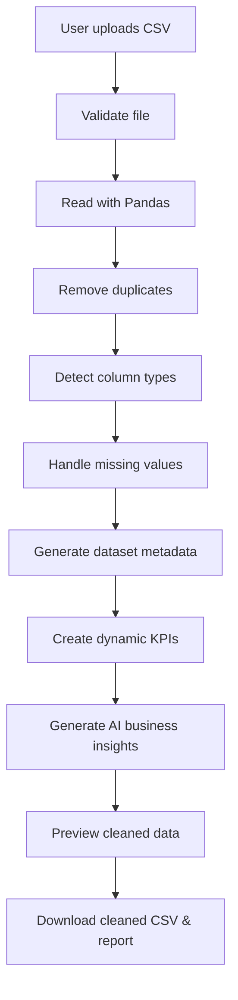

# AI-Powered Data Analysis Assistant

An intelligent data analysis platform that automatically inspects, cleans, preprocesses, and analyzes uploaded CSV datasets using **Python, Pandas, Flask, and Gemini AI**. The application transforms raw tabular data into meaningful KPIs and business insights with minimal user effort while preserving a privacy-first preprocessing pipeline.

---

## Overview

Manual data cleaning is one of the most time-consuming tasks in data analysis. This project automates the complete preprocessing workflow and generates business-ready analytical insights through an interactive web interface.

Users simply upload a CSV file, and the platform automatically:

- Detects column types intelligently
- Removes duplicate records
- Handles missing values using adaptive imputation
- Converts valid date columns
- Generates dynamic KPI cards
- Produces AI-powered business insights
- Lets users preview and download the cleaned dataset

---

## Key Features

### Intelligent Data Preprocessing
- Automatic column type detection
- Duplicate row removal
- Adaptive missing value handling
- Datetime conversion
- Data standardization

### Dynamic Business Analytics
- Dataset-aware KPI generation
- Automatic business metric detection
- Category-level analytical summaries
- Statistical trend extraction

### AI Insight Generation
- Gemini-powered business insights
- Context-aware analytical observations
- Lightweight summary sent to AI (not the raw dataset)

### Export & Preview
- Interactive cleaned dataset preview
- Download cleaned CSV
- Download analysis report

---

## System Architecture



---

## End-to-End Workflow



---

## Project Structure

```text
AI-Powered-Data-Analysis-Assistant/

│
├── app.py                      # Flask routes & request handling
├── config.py                   # Gemini API configuration
├── requirements.txt
├── README.md
│
├── utils/
│   ├── data_processor.py       # Cleaning & preprocessing engine
│   ├── analytics_engine.py     # KPIs, metadata & rule-based analytics
│   └── ai_insights.py          # Gemini insight generation
│
├── templates/
│   └── index.html              # Web interface
│
├── static/
│   ├── css/
│   └── js/
|
│── scratch/
│   └── test_pipeline.py        # To run the test cases
| 
└── uploads/                    # Temporary processing files
```

---

## How the Platform Works

### Step 1 : Upload

The user uploads any CSV dataset through the web interface. The backend validates the file format and loads it into a Pandas DataFrame.

### Step 2 : Intelligent Preprocessing

The preprocessing engine automatically performs:

- Exact duplicate removal
- Missing value detection
- Adaptive imputation (Mean / Median / Mode)
- Date conversion
- Column type identification

No manual schema definition is required.

### Step 3 : Column Classification

Each column is classified into one of the following categories:

| Type | Example |
|------|---------|
| Identifier | Customer ID |
| Business Metric | Revenue, Salary |
| Date | Order Date |
| Boolean | Is Active |
| Categorical | Region |
| Numeric | Age, Quantity |

This classification drives the entire analytics pipeline.

### Step 4 : Dynamic KPI Generation

Instead of hardcoded metrics, the platform inspects the uploaded dataset and generates only the KPIs that make sense.

Examples include:

- Total Records
- Total Features
- Average Revenue
- Maximum Salary
- Top Category

The KPI cards automatically change depending on the dataset.

### Step 5 : AI Business Insights

The cleaned dataset is converted into a **lightweight analytical summary** containing:

- Column names
- Data types
- Descriptive statistics
- Category distributions
- Aggregated analytical information

This summary is sent to **Gemini AI**, which generates business-friendly insights. The raw preprocessing logic remains entirely local in Pandas.

### Step 6 : Preview & Export

Users can:

- Inspect the cleaned dataset
- View KPIs and AI insights
- Download the cleaned CSV
- Download the generated analysis report

---

## Adaptive Missing Value Strategy

The platform chooses the imputation method based on the data rather than using one fixed rule.

| Column Type | Strategy |
|------------|----------|
| Numeric (with outliers) | Median |
| Numeric (no outliers) | Mean |
| Categorical | Mode |
| Boolean | Mode |
| Date | Most frequent date |

Outliers are detected using the **Interquartile Range (IQR)** method before selecting Mean or Median.

---

## Dynamic KPI Logic

The KPI engine follows a rule-based decision pipeline.

```text
Detect column types
        │
        ▼
Identify business metrics
        │
        ▼
Select meaningful columns
        │
        ▼
Calculate relevant KPIs
        │
        ▼
Return JSON → Dashboard Cards
```

This allows the same application to work across retail, HR, finance, education, healthcare, and other tabular datasets.

---

## Privacy First

The preprocessing pipeline runs **locally using Pandas**.

- Raw uploaded files are stored only temporarily during processing.
- Temporary files are automatically deleted after completion.
- The AI module receives a lightweight analytical summary rather than relying on Gemini for data cleaning.
- Core preprocessing and KPI generation continue to work independently of the AI layer.

---

## Tech Stack

| Category | Technology |
|----------|------------|
| Language | Python |
| Backend | Flask |
| Data Processing | Pandas, NumPy |
| AI | Gemini API |
| Frontend | HTML, CSS, JavaScript |

---

## How to Install and Run Locally

1. **Clone the Repository**
   ```bash
   git clone <repository-url>
   cd ai-data-analysis-assistant
   ```

2. **Install Dependencies**
   ```bash
   pip install -r requirements.txt
   ```

3. **Configure Gemini API**

   Create a `.env` file in the project root and add:

   ```
   GEMINI_API_KEY=your_gemini_api_key_here
   ```

   The application loads this automatically using `python-dotenv`.

   > If you prefer, you can also set `GEMINI_API_KEY` as a system environment variable instead of using a `.env` file.


4. **Run the Application**
   ```bash
   python app.py
   ```

5. **Open the Application**

   Visit:

   ```
   http://127.0.0.1:5000
   ```

6. **Upload Any CSV Dataset**

   Upload your own CSV file, review the generated KPIs and AI-powered insights, then download the cleaned dataset.

---

## Benefits

- Saves significant time by automating repetitive data cleaning and preprocessing tasks.
- Generates AI-powered business insights within seconds, reducing manual analysis effort.
- Adapts automatically to different dataset structures without requiring custom code.
- Helps users identify key trends, KPIs, and data quality issues quickly.
- Enables analysts to download a cleaned dataset for further analysis or reporting.
- Provides an intuitive interface that allows both technical and non-technical users to analyze datasets easily

## Future Scope

- User authentication with personalized accounts
- Individual analysis history for every user
- Reopen previous datasets without reprocessing
- Local LLM support for fully offline AI insight generation

---

## Author

**Aqif**

B.Tech CSE (AI & ML) | Data Analytics & AI